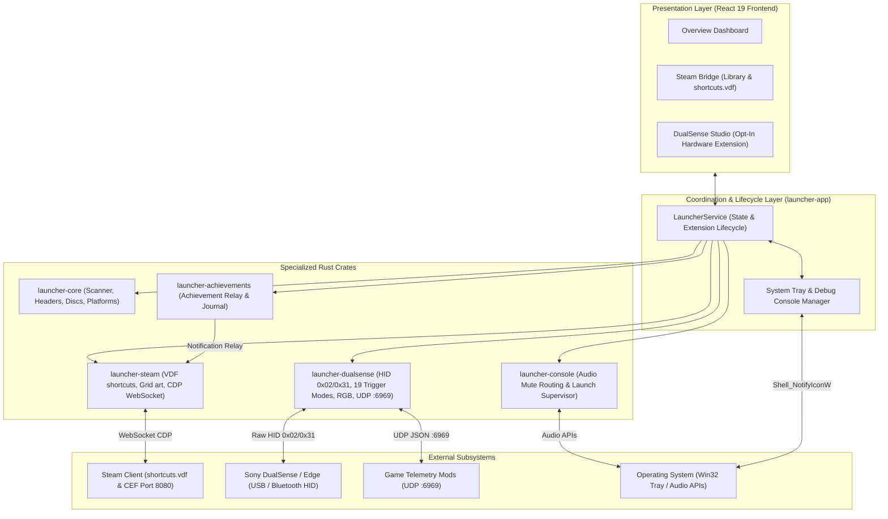

# System Architecture: Kame House Launcher 🐢

This document outlines the system design, crate separation of concerns, data flows, and external integrations for **Kame House Launcher**.

<p align="center">
  <b>English</b> · <a href="ARCHITECTURE.pt-BR.md">Português (Brasil)</a>
</p>

---

## 1. Architectural Overview

Kame House Launcher is built as an event-driven, modular Rust application organized into specialized crates:



---

## 2. Crate Responsibilities

### `launcher-core`
- **Platform Catalog:** Immutable mapping of 30+ game systems, metadata IDs, and supported extensions.
- **Cartridge Header Inspection (`headers.rs`):** Zero-allocation reading of ROM headers for Game Boy Advance, Nintendo DS, Game Boy/Color, Nintendo 64 (with endianness swapping), Sega Genesis, and Super Nintendo (LoROM/HiROM checksum complement verification).
- **Disc Sector Reader (`disc.rs`):** Low-level ISO9660 Primary Volume Descriptor (PVD) parser extracting `SYSTEM.CNF` and `PARAM.SFO`.
- **PE Metadata Inspection (`pe.rs`):** Extraction of `ProductName` and local Steam AppID discovery (`steam_appid.txt`, `steam_emu.ini`, manifest files).
- **Multi-threaded Scanner (`scanner.rs`):** Concurrent multi-disk traversal powered by `rayon` and `walkdir`.

### `launcher-steam`
- **Binary VDF Engine (`vdf.rs`):** Recursive parser and atomic serializer for Valve's binary Data Format (`shortcuts.vdf`).
- **Deterministic Shortcut AppID:** CRC32 32-bit hash calculation:
  ```text
  shortcut_id = (CRC32(exe + AppName) | 0x80000000)
  ```
- **Grid Artwork Manager (`grid.rs`):** Positions covers, heroes, logos, wide banners, and icons into Steam's `grid/` folder.
- **CDP WebSocket Bridge (`cdp.rs`):** Async Chrome DevTools Protocol client connecting to Steam CEF on port `8080` to attach to `SharedJSContext` and trigger native achievement notifications.

### `launcher-achievements`
- **Unified Tracker (`manager.rs`):** Data models for achievements, unlock events, and persistent activity journal (`activity.json`).
- **Log Parsers (`models.rs`):** Detects achievement unlocks from emulator logs and relays them to the Steam bridge.

### `launcher-dualsense`
- **Opt-In Extension Lifecycle (`manager.rs`, `device.rs`):** Remains disabled (`OFF`) by default at startup unless configured by the user to autostart (`dualsense_extension_enabled`). Dynamically spawns or stops the `HidDeviceWorker` and UDP telemetry listener on demand.
- **Pure Rust HID Communication (`protocol.rs`, `device.rs`):** Low-level communication with Sony DualSense and DualSense Edge over USB (Output Report ID `0x02`) and Bluetooth (Output Report ID `0x31` with IEEE 802.3 CRC32 checksum trailer, rolling sequence number, and Feature Report `0x05` unlock).
- **Adaptive Trigger Engine (`triggers.rs`):** Compiles 19 trigger effect modes into Sony 11-byte payloads for L2 and R2: `Off`, `Feedback`, `Weapon`, `Bow`, `Galloping`, `MachineGun`, `Machine`, `Vibration`, `GameCube`, `Choppy`, `VerySoft`, `Soft`, `Medium`, `Hard`, `VeryHard`, `Hardest`, `Rigid`, `VibrateTriggerPulse`, and `CustomZone`.
- **RGB Lightbar & Player LEDs (`lightbar.rs`):** Lighting engine supporting Static, Breathing glow, Rainbow cycle, and real-time battery status coloring, plus Player 1–4 LEDs and Microphone mute LED.
- **UDP Telemetry Server (`udp_server.rs`):** Async UDP server listening on port `6969`, accepting incoming JSON instructions from game telemetry mods.
- **Controller Emulation & Gyro (`emulation.rs`):** Virtual controller profiles (Native DualSense, Xbox 360 XInput, DualShock 4) and 6-axis IMU gyro-to-stick camera mapping.

### `launcher-console`
- **Launch Supervisor (`supervisor.rs`):** Manages game execution window states (`HideAndRestoreFullscreen` and `KeepOpen`).
- **System Audio & Microphone Control (`audio.rs`):** Synchronizes physical DualSense microphone mute button toggles with the operating system's default recording device.

### `launcher-app`
- **Central Coordinator (`service.rs`):** `LauncherService` aggregating state, game catalog persistence, settings, and extension lifecycle.
- **Embedded HTTP Server (`server.rs`):** Serves the bundled React 19 UI and REST API endpoints on `127.0.0.1:48080` (with automatic port fallback).
- **System Tray & Window Lifecycle (`tray.rs`):** Hides the startup terminal window, manages the Windows System Tray icon (`Shell_NotifyIconW`), toggles the on-demand Debug Terminal (`Logs`), and handles the Minimize-to-Tray vs. Quit confirmation prompt on window close (`X`).
- **Internationalization Engine (`i18n.rs`) & CLI (`cli.rs`):** Bilingual (`en` and `pt-BR`) command-line interface and runtime dictionary.
