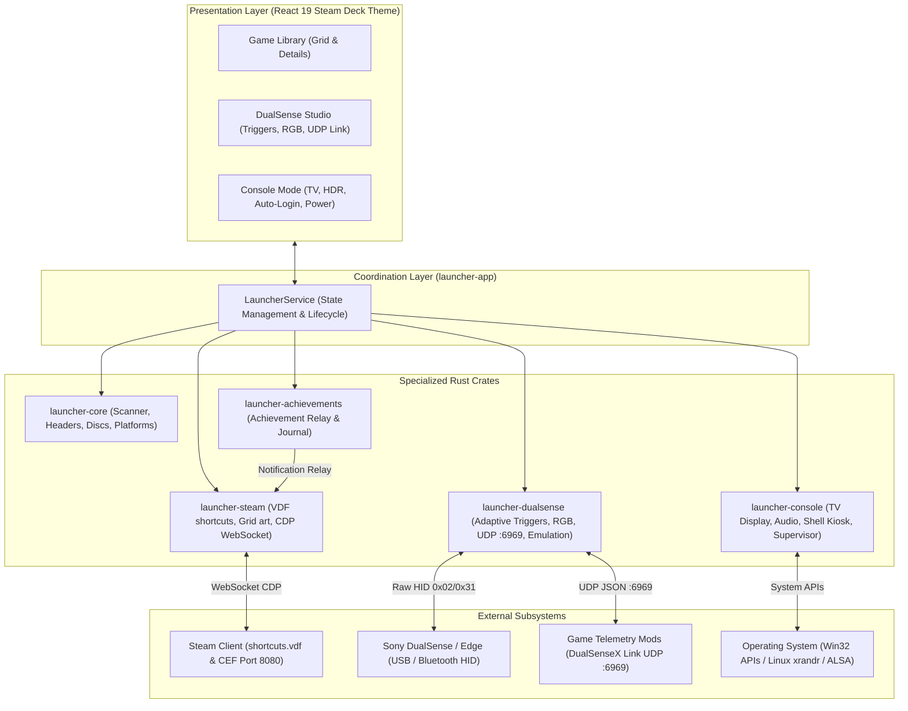

# System Architecture: Kame House Launcher 🐢

This document outlines the system design, crate separation of concerns, data flows, and external integrations for **Kame House Launcher**.

<p align="center">
  <b>English</b> · <a href="ARCHITECTURE.pt-BR.md">Português (Brasil)</a>
</p>

---

## 1. Architectural Overview

Kame House Launcher is built as an event-driven, modular Rust application organized into specialized crates:



---

## 2. Crate Responsibilities

### `launcher-core`
- **Platform Catalog:** Immutable mapping of 30+ game systems, metadata IDs (IGDB, RetroAchievements, libretro), and supported extensions.
- **Cartridge Header Inspection (`headers.rs`):** Zero-allocation reading of ROM headers for Game Boy Advance, Nintendo DS, Game Boy/Color, Nintendo 64 (with endianness swapping), Sega Genesis, and Super Nintendo (LoROM/HiROM checksum complement verification).
- **Disc Sector Reader (`disc.rs`):** Low-level ISO9660 Primary Volume Descriptor (PVD) parser extracting `SYSTEM.CNF` and `PARAM.SFO`.
- **PE Metadata Inspection (`pe.rs`):** Extraction of `ProductName` and local Steam AppID discovery (`steam_appid.txt`, `steam_emu.ini`, manifest files).
- **Multi-threaded Scanner (`scanner.rs`):** Concurrent multi-disk traversal powered by `rayon` and `walkdir`.

### `launcher-steam`
- **Binary VDF Engine (`vdf.rs`):** Recursive parser and atomic serializer for Valve's binary Data Format (`shortcuts.vdf`).
- **Deterministic Shortcut AppID:** CRC32 32-bit hash calculation:
  ```text
  shortcut_id = (CRC32(exe + AppName) | 0x80000000)
  ```
- **Grid Artwork Manager (`grid.rs`):** Positions covers, heroes, logos, wide banners, and icons into Steam's `grid/` folder.
- **CDP WebSocket Bridge (`cdp.rs`):** Async Chrome DevTools Protocol client connecting to Steam CEF on port `8080` to attach to `SharedJSContext` and trigger native achievement notifications.

### `launcher-achievements`
- **Unified Tracker (`manager.rs`):** Data models for achievements, unlock events, and persistent activity journal (`activity.json`).
- **Log Parsers (`models.rs`):** Detects achievement unlocks from emulator logs (such as RPCS3) and relays them to the Steam bridge.

### `launcher-dualsense`
- **Pure Rust HID Communication (`protocol.rs`):** Low-level communication with Sony DualSense and DualSense Edge over USB (Output Report ID 0x02) and Bluetooth (Output Report ID 0x31 with IEEE 802.3 CRC32 checksum trailer calculated via `crc32fast`).
- **Adaptive Trigger Engine (`triggers.rs`):** Compiles trigger effects into official Sony 11-byte payloads for L2 and R2: Feedback, Semi-Auto Weapon snap, Bow draw & snap, Machine Gun kick, Galloping rhythm, Vibration pulse, and Custom 10-zone curves.
- **RGB Lightbar & Player LEDs (`lightbar.rs`):** Lighting engine supporting Static, Breathing glow, Rainbow cycle, and real-time battery status coloring, plus Player 1-4 LEDs.
- **DualSenseX Link UDP Server (`udp_server.rs`):** Async UDP server listening on port `6969`, accepting incoming JSON instructions from existing community game mods (Assetto Corsa, F1 23, Cyberpunk 2077, etc.).
- **Controller Emulation & Gyro (`emulation.rs`):** Virtual controller profiles (Native DualSense, Xbox 360 XInput, DualShock 4) and 6-axis IMU gyro-to-stick camera mapping.
- **Curated Profiles (`profiles.rs`):** Built-in trigger presets for Racing (ABS pulse + throttle resistance), Tactical FPS shooters, Flight simulators, and PlayStation classic.

### `launcher-console`
- **Launch Supervisor (`supervisor.rs`):** Manages both execution behaviors:
  1. `HideAndRestoreFullscreen`: Minimizes/hides the launcher during gameplay and restores it in fullscreen with immediate gamepad focus on exit.
  2. `KeepOpen`: Keeps the launcher active in the background.
- **TV Display Settings (`models.rs`):** Presets for 4K @ 120Hz, 1440p @ 120Hz, 1080p @ 120Hz, and HDR activation.
- **System Boot (`boot.rs`):** Auto-login helpers (`AutoAdminLogon` on Windows / autostart desktop entry on Linux).
- **Power Management (`power.rs`):** Controller-mapped Sleep, Hibernate, Restart, and Shutdown commands.

### `launcher-app`
- **Central Coordinator (`service.rs`):** `LauncherService` aggregating state, game catalog persistence, settings, and IPC calls.
- **Internationalization Engine (`i18n.rs`):** Bilingual dictionary with English default (`en`) and complete Portuguese (`pt-BR`) support.
- **CLI Commands & Flags (`cli.rs`):** Command-line parser supporting `--lang`, `--set-lang`, `status`, `scan`, `export-steam`, and `set-mode`.
- **Application Binary (`main.rs`):** CLI entrypoint with structured logging via `tracing-subscriber`.
