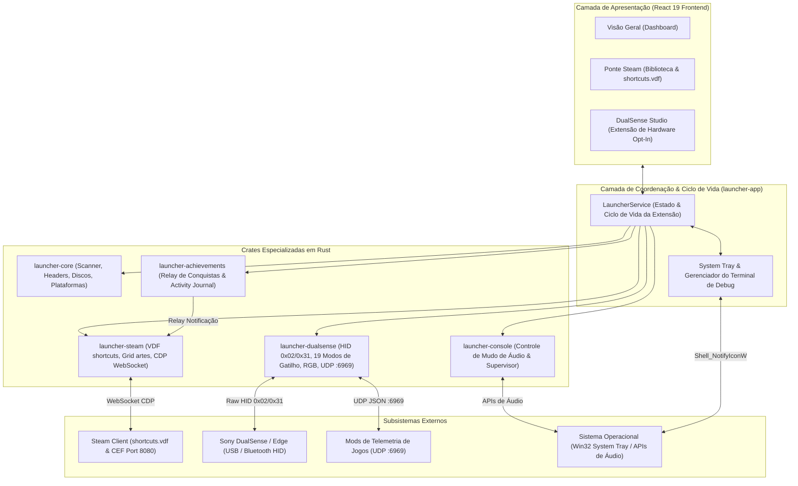

# Arquitetura do Sistema: Kame House Launcher 🐢

Este documento detalha o design de software, a divisão de responsabilidades das crates, os fluxos de dados e as integrações de sistema do **Kame House Launcher**.

<p align="center">
  <a href="ARCHITECTURE.md">English</a> · <b>Português (Brasil)</b>
</p>

---

## 1. Visão Geral da Arquitetura

O Kame House Launcher adota uma arquitetura em camadas orientada a eventos e crates modulares em Rust:



---

## 2. Responsabilidades por Crate

### `launcher-core`
- **Catálogo de Plataformas:** Mapeamento imutável de mais de 30 plataformas de jogos, IDs de metadados e extensões de arquivos suportadas.
- **Leitor de Cabeçalhos de Cartuchos (`headers.rs`):** Inspeção com zero alocação de ROMs de GBA, NDS, Game Boy/Color, Nintendo 64 (com rotação de endianness), Sega Genesis e SNES (complement check).
- **Leitor de Imagens de Disco (`disc.rs`):** Parser ISO9660 PVD de baixo nível extraindo `SYSTEM.CNF` e `PARAM.SFO`.
- **Inspeção de Executáveis PE (`pe.rs`):** Recuperação de `ProductName` e busca de evidências locais de AppID da Steam (`steam_appid.txt`, `steam_emu.ini`, manifestos).
- **Scanner Multi-thread (`scanner.rs`):** Varredura concorrente em múltiplos discos através de `rayon` e `walkdir`.

### `launcher-steam`
- **Manipulador Binário de VDF (`vdf.rs`):** Parser recursivo do formato Valve Data Format binário e encoder atômico para `shortcuts.vdf`.
- **Cálculo de Shortcut AppID:** Hash determinístico de 32 bits:
  ```text
  shortcut_id = (CRC32(exe + AppName) | 0x80000000)
  ```
- **Gerenciador de Artes do Grid (`grid.rs`):** Sincronização de capas, heroes, logos, imagens wide e ícones na pasta da Steam.
- **Bridge CDP WebSocket (`cdp.rs`):** Conexão assíncrona ao Chrome DevTools Protocol da Steam em `127.0.0.1:8080` com anexo ao `SharedJSContext` para envio de notificações nativas de conquistas.

### `launcher-achievements`
- **Monitor de Conquistas (`manager.rs`):** Modelo de dados unificado para troféus, eventos de desbloqueio e histórico persistente (`activity.json`).
- **Parsers de Log (`models.rs`):** Reconhecimento de eventos de desbloqueio em logs de emuladores e encaminhamento ao bridge da Steam.

### `launcher-dualsense`
- **Ciclo de Vida como Extensão Opt-In (`manager.rs`, `device.rs`):** Inicia desativada (`OFF`) por padrão para não alocar threads ou monitorar portas USB/Bluetooth sem necessidade, a menos que o usuário habilite a inicialização automática (`dualsense_extension_enabled`). Inicia ou encerra dinamicamente o `HidDeviceWorker` e o servidor UDP sob demanda.
- **Comunicação HID Direta em Rust Puro (`protocol.rs`, `device.rs`):** Protocolo Sony DualSense e DualSense Edge via USB (Output Report `0x02`) e Bluetooth (Output Report `0x31` com checksum CRC32 IEEE 802.3, contador sequencial e desbloqueio via Feature Report `0x05`).
- **Motor de Gatilhos Adaptáveis (`triggers.rs`):** Compilação de 19 modos de efeito nos buffers de hardware oficiais de 11 bytes para L2 e R2: `Off`, `Feedback`, `Weapon`, `Bow`, `Galloping`, `MachineGun`, `Machine`, `Vibration`, `GameCube`, `Choppy`, `VerySoft`, `Soft`, `Medium`, `Hard`, `VeryHard`, `Hardest`, `Rigid`, `VibrateTriggerPulse` e curvas de 10 zonas (`CustomZone`).
- **Barra de Luz RGB & LEDs de Jogador (`lightbar.rs`):** Efeitos estáticos, pulsação suave, ciclo arco-íris e indicador dinâmico de nível de bateria, além de LEDs indicadores de Jogador 1 a 4 e LED de microfone.
- **Servidor de Telemetria UDP (`udp_server.rs`):** Servidor assíncrono em `tokio::net::UdpSocket` na porta `6969`, decodificando pacotes JSON de telemetria enviados por mods de jogos.
- **Emulação de Controles & Giroscópio (`emulation.rs`):** Perfis de controle virtual (DualSense Nativo, Xbox 360 XInput, DualShock 4) e mapeamento do giroscópio IMU de 6 eixos.

### `launcher-console`
- **Supervisor de Janelas (`supervisor.rs`):** Gerencia a transição de estado ao iniciar e encerrar jogos (`HideAndRestoreFullscreen` e `KeepOpen`).
- **Controle de Áudio e Microfone (`audio.rs`):** Sincroniza o botão físico de mudo do microfone do DualSense com o dispositivo de gravação do sistema operacional.

### `launcher-app`
- **Serviço Central (`service.rs`):** `LauncherService` agregando estado, persistência de catálogo, configurações e ciclo de vida da extensão DualSense.
- **Servidor HTTP Embarcado (`server.rs`):** Serve os ativos estáticos da interface React 19 e as rotas da API REST em `127.0.0.1:48080` (com fallback automático de porta).
- **System Tray & Ciclo de Vida da Janela (`tray.rs`):** Oculta o terminal na inicialização, gerencia o ícone nativo na bandeja do Windows (`Shell_NotifyIconW`), alterna o Terminal de Debug (`Logs`) sob demanda e exibe o diálogo de confirmação (Minimizar para o Tray vs. Encerrar) ao fechar a janela (`X`).
- **Internacionalização (`i18n.rs`) & CLI (`cli.rs`):** Interface de linha de comando e dicionário bilíngue (`en` e `pt-BR`).
