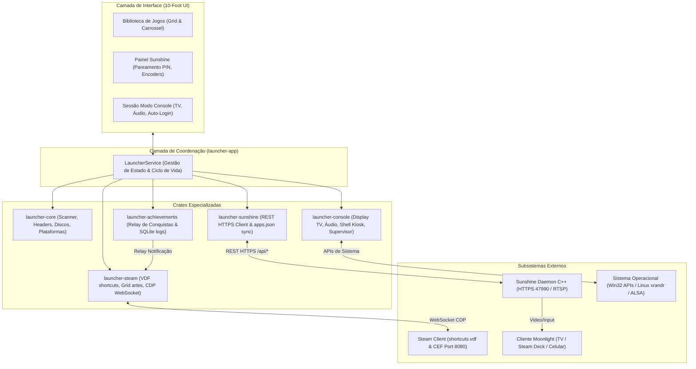

# Arquitetura do Sistema: Kame House Launcher 🐢

Este documento detalha o design de software, a divisão de responsabilidades das crates, os fluxos de dados e as integrações de sistema do **Kame House Launcher**.

---

## 1. Visão Geral da Arquitetura

O Kame House Launcher adota uma arquitetura em camadas orientada a eventos e crates modulares em Rust:



---

## 2. Responsabilidades por Crate

### `launcher-core`
- **Catálogo de Plataformas:** Mapeamento imutável de mais de 30 plataformas de jogos, IDs de metadados externos (IGDB, RetroAchievements, libretro) e extensões de arquivos suportadas.
- **Leitor de Cabeçalhos de Cartuchos (`headers.rs`):** Inspeção com zero alocação de ROMs de GBA, NDS, Game Boy/Color, Nintendo 64 (com rotação de endianness), Sega Genesis e SNES (complement check).
- **Leitor de Imagens de Disco (`disc.rs`):** Parser ISO9660 PVD de baixo nível e leitor de descritores de volume, extraindo `SYSTEM.CNF` e `PARAM.SFO`.
- **Inspeção de Executáveis PE (`pe.rs`):** Recuperação de `ProductName` e busca de evidências locais de AppID da Steam (`steam_appid.txt`, `steam_emu.ini`, manifestos).
- **Scanner Multi-thread (`scanner.rs`):** Varredura concorrente em múltiplos discos através de `rayon` e `walkdir`.

### `launcher-steam`
- **Manipulador Binário de VDF (`vdf.rs`):** Parser recursivo do formato Valve Data Format binário e encoder atômico para `shortcuts.vdf`.
- **Cálculo de Shortcut AppID:** Hash determinístico de 32 bits:
  ```text
  shortcut_id = (CRC32(exe + AppName) | 0x80000000)
  ```
- **Gerenciador de Artes do Grid (`grid.rs`):** Sincronização de capas, heroes, logos, imagens wide e ícones na pasta da Steam.
- **Bridge CDP WebSocket (`cdp.rs`):** Conexão assíncrona ao Chrome DevTools Protocol da Steam em `127.0.0.1:8080` com anexo ao `SharedJSContext` para envio de notificações nativas de conquistas.

### `launcher-achievements`
- **Monitor de Conquistas (`manager.rs`):** Modelo de dados unificado para troféus e eventos de desbloqueio.
- **Histórico Persistente:** Gravação atômica em `activity.json`.
- **Parsers de Log (`models.rs`):** Reconhecimento de eventos de desbloqueio em logs de emuladores (como RPCS3) e encaminhamento ao bridge da Steam.

### `launcher-sunshine`
- **Cliente REST HTTPS (`client.rs`):** Comunicação assíncrona com Sunshine em `https://127.0.0.1:47990` com tratamento de CSRF tokens e certificados autoassinados locais.
- **Pareamento por PIN:** Implementação da rota `/api/pin` para pareamento direto de clientes Moonlight.
- **Sincronizador de Aplicativos (`sync.rs`):** Mapeamento do catálogo do launcher para o formato `apps.json` do Sunshine.
- **Rastreamento Upstream:** Sunshine mantido como submódulo Git no diretório `Sunshine/`.

### `launcher-console`
- **Supervisor de Janelas (`supervisor.rs`):** Gerencia os dois comportamentos de execução:
  1. `HideAndRestoreFullscreen`: Oculta o launcher durante a execução do jogo e o restaura com foco imediato no controle ao fechar.
  2. `KeepOpen`: Mantém o launcher aberto em segundo plano.
- **Configurações de TV (`models.rs`):** Presets para 4K a 120Hz, 1440p a 120Hz, 1080p a 120Hz e ativação de HDR.
- **Inicialização do Sistema (`boot.rs`):** Automação de auto-login (`AutoAdminLogon` no Windows / desktop autostart no Linux).
- **Ações de Energia (`power.rs`):** Comandos nativos para Suspender, Hibernar, Reiniciar e Desligar via controle.

### `launcher-app`
- **Serviço Central (`service.rs`):** `LauncherService` agregando estado, persistência de catálogo e chamadas IPC.
- **Binário Executável (`main.rs`):** Ponto de entrada com logging estruturado via `tracing-subscriber`.

