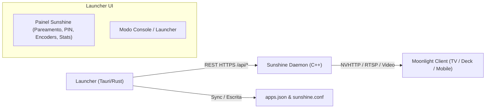

# ADR 0002: Integração com Sunshine, Substituição do Frontend e Rastreamento Upstream

- **Status:** Proposto (Aceito para Planejamento)
- **Data:** 2026-10-22
- **Decisores:** Time de Desenvolvimento / Engenharia

## Contexto e Declaração do Problema

O [Sunshine](https://github.com/LizardByte/Sunshine) é o servidor de streaming de jogos open source líder de mercado (compatível com clientes Moonlight). Ele é escrito em C++ e possui um servidor HTTP interno (`confighttp.cpp`) que expõe tanto uma API REST completa em `/api/...` quanto uma interface web legada baseada em Vue 3 (`src_assets/common/assets/web`).

O usuário especificou três requisitos fundamentais:
1. **Integração completa com o Sunshine:** Descartar a interface web atual do Sunshine e utilizar nosso próprio frontend integrado dentro do launcher.
2. **Extensão sem apropriação ou reinventar a roda:** Não reinventar nenhum código de captura, codificação de vídeo, RTSP ou entrada que o Sunshine já faz brilhantemente.
3. **Manter-se sempre atualizado com o código de infraestrutura mais recente do Sunshine**, concedendo os devidos créditos aos autores originais.

## Decisão

Adotamos uma arquitetura de **Plano de Controle Separado (Headless Daemon + Native Embedded UI)**:

### 1. Descarte do Frontend Web do Sunshine e Nova UI Integrada
- O Sunshine é executado em modo de serviço de segundo plano (daemon).
- O nosso launcher se comunica com a API REST HTTPS local do Sunshine (porta padrão `47990` com autenticação por credencial/token seguro ou CSRF) através da crate Rust `launcher-sunshine`.
- Dentro da interface do launcher, criamos uma aba nativa de **Remote Play / Sunshine**:
  - **Diálogo de Pareamento Instantâneo:** Quando o Moonlight solicita pareamento, o launcher exibe um pop-up na tela estilo console para digitar o PIN de 4 dígitos ou aprovar conexões ativas.
  - **Gerenciador de Aplicativos Transmitidos:** Sincronização automática da biblioteca de jogos do launcher para o `apps.json` do Sunshine, permitindo inclusive lançar diretamente o próprio launcher em modo Big Picture no dispositivo cliente.
  - **Configurações de Codificador & Vídeo:** Presets fáceis para TV (4K 60/120fps, HDR, AV1/HEVC/H.264, bitrate adaptativo, emulação de gamepad ViGEmBus/uinput).
  - **Monitor de Status e Logs:** Estado do daemon (Ativo, Em Streaming, Inativo) e consumo de banda em tempo real.

### 2. Rastreamento Upstream e Manutenção Contínua
- O repositório Sunshine é mantido como **Git Submodule** (ou acompanhado por branch de vendor) apontando para o upstream oficial `https://github.com/LizardByte/Sunshine.git`.
- Nenhum arquivo do núcleo de captura ou streaming do C++ é modificado ou forkeado com alterações incompatíveis.
- **Fluxo de Atualização Upstream:**
  - Script automatizado de verificação de releases e tags upstream (`tools/sync-sunshine-upstream.sh`).
  - Execução de testes de integração da API `/api/*` a cada nova versão do Sunshine para garantir compatibilidade retroativa e detectar eventuais adições de endpoints.
- **Créditos e Atribuição:**
  - Inclusão visível no menu "Sobre / Créditos" do launcher destacando: *"Streaming powered by Sunshine - Copyright (C) LizardByte & Sunshine Contributors (GPL-3.0)"*.
  - Exibição de links oficiais para o projeto Sunshine, documentação e repositório.

## Consequências

### Positivas
- **Experiência Unificada para o Usuário:** O usuário nunca precisa abrir um navegador web separado nem lidar com certificados auto-assinados de navegador para emparelhar a TV ou ajustar uma resolução.
- **Zero Duplicação de Esforço Técnico:** Toda a complexidade de captura de tela de baixíssima latência (Desktop Duplication API, DXGI, KMS/DRM, NVENC, QuickSync, AMF, VAAPI) é delegada à robustez do Sunshine.
- **Manutenibilidade Superior:** Quando a equipe do LizardByte lançar novas otimizações de codificação ou correções de segurança, nosso launcher se atualiza simplesmente atualizando o submódulo ou o binário do Sunshine, sem riscos de quebra.

