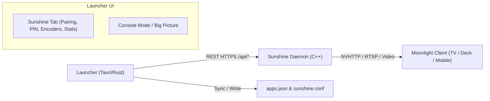

# ADR 0002: Headless Sunshine Integration, Frontend Replacement, and Upstream Tracking

- **Status:** Accepted
- **Date:** 2026-10-22
- **Deciders:** Engineering Team

  <b>English</b> · <a href="0002-sunshine-integration-and-upstream-tracking.pt-BR.md">Português (Brasil)</a>

## Context and Problem Statement

[Sunshine](https://github.com/LizardByte/Sunshine) is the industry-standard open-source game streaming server for Moonlight clients. It is written in C++ and contains an internal HTTP/HTTPS server (`confighttp.cpp`) exposing a complete REST API at `/api/...` as well as a legacy web UI.

The core project requirements are:
1. **Complete Sunshine Integration:** Bypass/discard Sunshine's default web UI and provide our own native, controller-friendly frontend inside the launcher.
2. **Extension Without Reinventing or Appropriating:** Do not reinvent screen capture, video encoding (NVENC, AMF, QuickSync), RTSP, or virtual input devices.
3. **Continuous Upstream Synchronization:** Stay continuously updated with Sunshine's latest C++ infrastructure code while giving full credit to the authors.

## Decision Outcome

Adopt a **Separated Control Plane Architecture (Headless Daemon + Native Embedded UI)**:

### 1. Discarding the Web UI & Embedding Native Controls
- Sunshine runs as an autonomous background daemon.
- The launcher communicates with Sunshine's local HTTPS REST API (default port `47990` with CSRF tokens) via the `launcher-sunshine` crate.
- Within the launcher, a dedicated **Remote Play / Sunshine** section provides:
  - **Instant PIN Pairing:** An on-screen 4-digit PIN dialog pops up when Moonlight requests pairing.
  - **Streamed Apps Synchronization:** Automatic sync between the launcher's library and Sunshine's `apps.json`, including a Big Picture launcher entry.
  - **Encoder & Display Presets:** Quick TV streaming presets (4K @ 60/120Hz, HDR, AV1/HEVC/H.264, adaptive bitrate).
  - **Status & Diagnostics:** Live daemon state and bandwidth monitoring.

### 2. Upstream Tracking and Licensing
- Sunshine is tracked cleanly as an official **Git Submodule** pointing to `https://github.com/LizardByte/Sunshine.git`.
- No C++ core files are modified or forked with incompatible changes.
- **Attribution Notice:** Prominently included in the about/credits dialog:  
  *"Streaming powered by Sunshine - Copyright (C) LizardByte & Sunshine Contributors (GPL-3.0)"*.

## Consequences

### Positive
- **Frictionless UX:** Users never have to open web browsers or accept self-signed SSL warnings from their couch.
- **Zero Duplication of Effort:** Complex low-latency capture (DXGI, Desktop Duplication, KMS/DRM) is delegated to Sunshine.
- **Long-term Maintainability:** Upstream bug fixes and encoder improvements flow in seamlessly via Git submodule updates.
