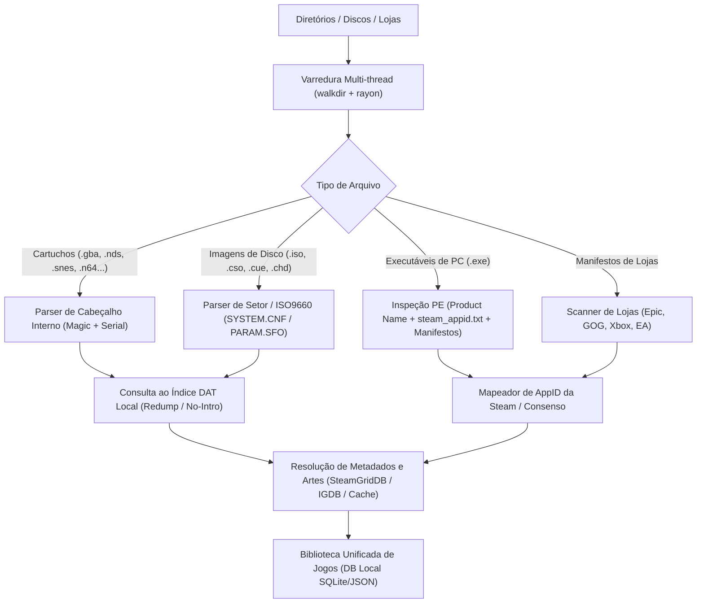

# ADR 0003: Motor de Varredura de Jogos, Identificação por Conteúdo e Metadados

- **Status:** Proposto (Aceito para Planejamento)
- **Data:** 2026-10-22
- **Decisores:** Time de Desenvolvimento / Engenharia

## Contexto e Declaração do Problema

Um launcher de jogos para console de sala de estar precisa encontrar automaticamente jogos em qualquer diretório ou loja do PC e identificá-los com precisão sem exigir chaves de API nem configurações manuais complexas pelo usuário.
A arquitetura do `launcher-core` suporta:
1. Varredura multi-thread em múltiplos discos e pastas configuradas.
2. Identificação por conteúdo interno (cabeçalhos de cartuchos, imagens de disco, arquivos de configuração internos, serials).
3. Detecção de lojas de jogos de PC instaladas (Epic Games, GOG Galaxy, Xbox/MS Store, EA, Ubisoft, Battle.net).
4. Desduplicação inteligente (ex.: port de PC junto com a ROM de console tornam-se uma única entrada limpa).
5. Enriquecimento de metadados e artes visuais (capas verticais, banners horizontais "hero", logos e ícones) sem depender obrigatoriamente de contas de terceiros.

## Decisão

Adotamos uma pipeline de identificação em estágios na crate `launcher-core`:

### 1. Parsers de Cabeçalho e Mídia em Rust
Implementados em Rust puro com zero alocação desnecessária e zero chamadas a ferramentas externas:
- **Cartuchos:** Extração dos primeiros bytes para detecção de magic bytes e serials de GBA, NDS, GB/GBC, N64 (com suporte a big-endian, byte-swapped e little-endian), Genesis/Mega Drive e SNES (LoROM/HiROM).
- **Discos:** Parser de descritores de volume ISO9660 primários (PVD), extração direta de `SYSTEM.CNF` (PS1/PS2), leitura de arquivos `PARAM.SFO` (PSP, PS3, PS Vita, PS4) e decodificação sob demanda de setores de ISO, CUE/BIN, CSO v1 e GDI.
- **Jogos de PC e Ports:** Leitura de metadados PE (`winres`/`pelite`) para recuperar `ProductName` e `FileDescription`; busca de evidências de AppID (`steam_appid.txt`, `steam_emu.ini`, `OnlineFix.ini`, `steam_settings`, manifestos de instalação).

### 2. Bancos de Dumps Verificados (DATs Redump e No-Intro)
- Download sob demanda dos arquivos DAT no formato CLRMAMEPRO mantidos pelo projeto `libretro-database`.
- Parser rápido em Rust com indexação por serial, MD5, CRC32, tamanho de arquivo e título normalizado.
- Cache local em disco com expiração de 30 dias.

### 3. Pipeline de Artes e Imagens
- Busca automatizada de artes em 4 categorias essenciais para a Steam e para o próprio launcher:
  - `cover`: 600x900 (capa vertical)
  - `hero`: 1920x620 (banner horizontal de fundo)
  - `logo`: imagem PNG com fundo transparente para o título
  - `icon`: 256x256 ou arquivo `.ico`
- Resolução multi-fonte em cascata: SteamGridDB / CDN Compartilhado -> Loja Oficial da Steam -> Libretro Thumbnails -> Wikipedia.

## Consequências

### Positivas
- **Desempenho Extremo:** A varredura de centenas de gigabytes de jogos em SSDs ou HDDs secundários ocorre em poucos segundos graças ao I/O assíncrono e paralelismo de CPU em Rust.
- **Identificação Confiável:** Elimina ambiguidades de nomes de arquivo (ex.: "game_final_v2.iso" é identificado corretamente pelo serial interno).
- **Autonomia Total:** O launcher é utilizável imediatamente após a instalação, sem exigir cadastros preliminares de API.

