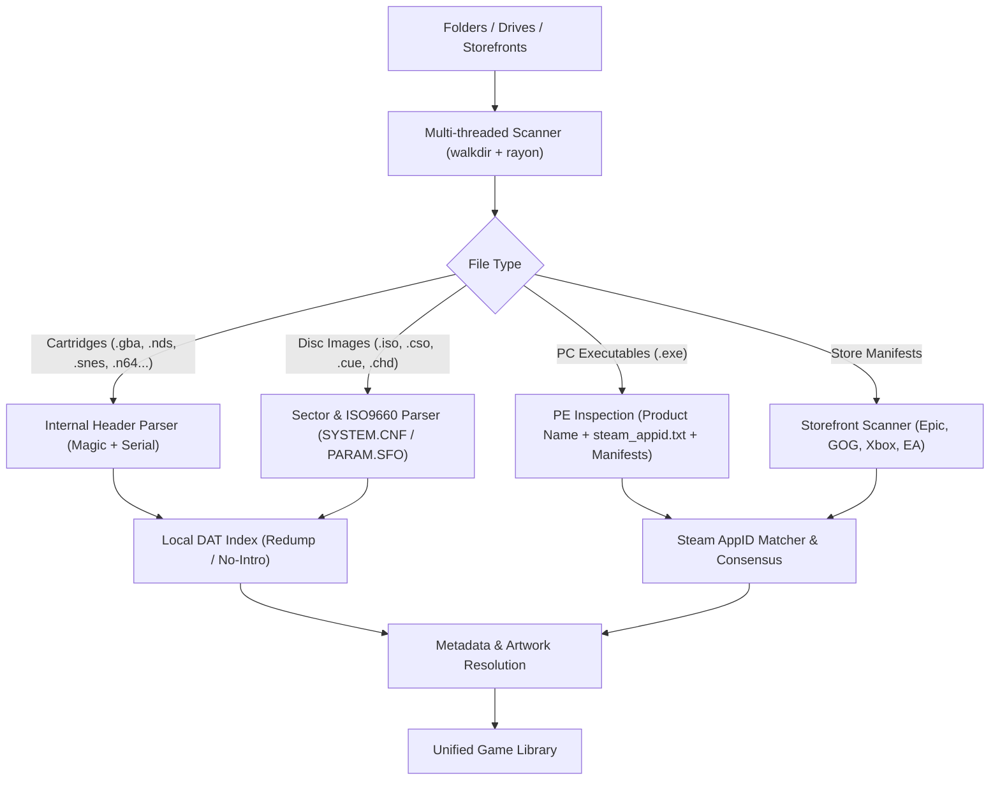

# ADR 0003: Content-Based Game Scanner, ROM Identifier, and Metadata Engine

- **Status:** Accepted
- **Date:** 2026-10-22
- **Deciders:** Engineering Team

  <b>English</b> · <a href="0003-game-scanner-and-rom-identification.pt-BR.md">Português (Brasil)</a>

## Context and Problem Statement

A living-room console game launcher must automatically locate games across arbitrary directories, storage drives, and digital storefronts, identifying each title accurately by its internal contents rather than fragile filenames, without forcing users to register third-party API keys.

The `launcher-core` crate fulfills these requirements by providing:
1. Multi-threaded filesystem scanning across multiple drives and folders.
2. Content-based binary identification (cartridge headers, disc sector descriptors, internal serials).
3. Detection of installed PC storefront games (Epic Games, GOG Galaxy, Xbox/MS Store, EA, Ubisoft).
4. Intelligent deduplication (e.g. PC ports combined cleanly with console dumps).
5. Artwork and metadata enrichment (vertical covers, horizontal hero banners, logos, and icons).

## Decision Outcome

Adopt a staged identification pipeline in `launcher-core`:

### 1. Pure Rust Binary Parsers
- **Cartridges:** Direct header inspection for Game Boy Advance, Nintendo DS, Game Boy/Color, Nintendo 64 (handling big-endian, byte-swapped, and word-swapped encodings), Sega Genesis, and Super Nintendo (LoROM/HiROM checksum complement verification).
- **Disc Sectors:** Low-level ISO9660 Primary Volume Descriptor (PVD) decoding, PlayStation `SYSTEM.CNF` extraction (PS1/PS2), and `PARAM.SFO` reading (PSP, PS3, PS4).
- **PC Executables & Ports:** PE metadata reading (`ProductName`, `FileDescription`) and local Steam AppID discovery (`steam_appid.txt`, `steam_emu.ini`, installation manifests).

### 2. Multi-Tier Artwork Hierarchy
Automatic retrieval for:
- `cover`: 600x900 (vertical poster)
- `hero`: 1920x620 (horizontal background banner)
- `logo`: transparent PNG game logo
- `icon`: executable icon or 256x256 PNG

## Consequences

### Positive
- **Extreme Speed:** Multi-threaded parallel traversal across SSDs and secondary HDDs completes in seconds via `rayon`.
- **Reliable Identification:** Prevents ambiguity caused by custom, compressed, or generic filenames.
- **Immediate Out-of-the-Box Usability:** Works immediately without requiring API keys or account logins.
