# ADR 0005: Sessão "Console Mode" e Transformação do PC em Console

- **Status:** Proposto (Aceito para Planejamento)
- **Data:** 2026-10-22
- **Decisores:** Time de Desenvolvimento / Engenharia

## Contexto e Declaração do Problema

Transformar um computador tradicional com Windows ou Linux em uma verdadeira central de entretenimento ("Living Room Console") exige eliminar as fricções típicas de um PC de mesa:
- Telas de bloqueio e senhas na inicialização;
- Barras de tarefas, notificações de segundo plano e pop-ups do sistema;
- Necessidade de mouse e teclado para ações rotineiras;
- Resoluções inadequadas para TV da sala, taxas de atualização de 60Hz em TVs de 120Hz e HDR desligado;
- Saídas de áudio presas nos fones de ouvido do escritório em vez da soundbar da TV;
- Desligamento ou suspensão da máquina sem controle remoto/gamepad.

O usuário solicitou explicitamente:
> *"quero ter uma sessão dentro do launcher que ajude o usuário a transformar seu pc o mais proximo de um console possivel."*

## Decisão

Criamos a crate Rust `launcher-console` e uma sessão de destaque no launcher chamada **"Modo Console"**, organizada em pilares de experiência de console:

```mermaid
flowchart TD
    subgraph ConsoleMode["Sessão: Modo Console"]
        direction TB
        A["1. Inicialização & Shell (Cold Boot)"]
        B["2. Display & Áudio para TV"]
        C["3. Navegação 10-Pés & Gamepad"]
        D["4. Otimização & Foco Sem Distrações"]
        E["5. Energia & Remote Play"]
    end
    
    A -->|"Helper"| A1["Auto-Login sem Senha (Win/Linux)"]
    A -->|"Autostart"| A2["Inicializar com o Sistema em Tela Cheia"]
    A -->|"Shell Mode"| A3["Ocultar Barra de Tarefas e Ícones"]
    
    B -->|"Display API"| B1["Alternador de Resolução (ex: 4K 120Hz)"]
    B -->|"HDR Toggle"| B2["Ativação/Calibração de HDR"]
    B -->|"Audio Switcher"| B3["Roteamento Automático de Som para HDMI/TV"]
    
    C -->|"Gamepad API"| C1["Controle 100% via Gamepad + Sons de Console"]
    C -->|"OSK"| C2["Teclado Virtual em Tela para Controle"]
    
    D -->|"Focus Assist"| D1["Silenciar Notificações do Windows"]
    D -->|"Cursor Hide"| D2["Ocultação Inteligente do Cursor do Mouse"]
    D -->|"Keep-Alive"| D3["Prevenir Suspensão Durante Jogo/Stream"]
    
    E -->|"Power Menu"| E1["Suspender / Desligar via Controle"]
    E -->|"WoL Setup"| E2["Configuração de Wake-on-LAN para Moonlight"]
```

### 1. Inicialização Direta ("Cold Boot into Console")
- **Assistente de Auto-Login:** Guias e automação segura para configurar o Windows para entrar automaticamente no usuário gamer sem pedir PIN/senha (`AutoAdminLogon` via API do Windows / autologin no Linux).
- **Modo Shell / Kiosk:** Opção de iniciar o launcher em modo tela cheia exclusivo na inicialização do sistema, minimizando a visibilidade da área de trabalho do Windows.
- **Suporte a Inicialização Silenciosa:** Instruções e ajustes para silenciar o logo e sons padrão do Windows, simulando a inicialização de um console de videogame dedicado.

### 2. Controle de Display e Áudio para Sala de Estar
- **Seletor de Display Primário:** Troca automática do monitor principal para a TV conectada via HDMI ao abrir o modo console.
- **Resolução e Taxa de Atualização:** Presets de um clique para 4K 120Hz, 1440p 120Hz, 1080p 120Hz, com suporte a Variable Refresh Rate (VRR) e G-Sync/FreeSync.
- **Alternador de HDR:** Ativação automática de HDR quando a TV suportar, com atalho para o calibrador de HDR do sistema.
- **Roteador de Dispositivos de Áudio:** Seleção instantânea da saída de áudio (HDMI da TV, Soundbar via eARC ou fone do controle) com verificação de canais surround (5.1 / 7.1).

### 3. Navegação de 10 Pés ("10-Foot Experience")
- **Mapeamento Total de Gamepad:** Suporte a controles de Xbox, PlayStation (DualShock 4 / DualSense) e Switch Pro via Gamepad API nativa.
- **Design de Som de Console:** Feedback sonoro sutil ao navegar (movimentação, seleção, voltar, erro), conferindo a mesma sensação tátil de um PS5 ou Nintendo Switch.
- **Teclado Virtual em Tela (OSK):** Interface de teclado navegável por D-pad/analógico para busca de jogos, digitação de credenciais e senhas Wi-Fi sem precisar de teclado físico.

### 4. Ambiente Imersivo e Sem Distrações
- **Ocultação Automática do Cursor:** O cursor do mouse desaparece automaticamente assim que qualquer botão do gamepad é pressionado.
- **Silenciamento de Notificações:** Ativação automática do modo "Não Perturbe" / "Focus Assist" durante o uso do launcher ou execução de jogos.
- **Supervisor de Foco de Jogo:** Quando um jogo é iniciado, o launcher se esconde ou minimiza para economizar GPU; quando o processo do jogo termina, o launcher volta à tela cheia em primeiro plano com foco imediato no controle.
- **Prevenção de Suspensão:** Bloqueio do descanso de tela e da suspensão de energia enquanto uma sessão de jogo ou streaming Sunshine estiver ativa (`SetThreadExecutionState` no Windows).

### 5. Menu de Energia e Acesso Remoto
- **Menu de Energia via Gamepad:** Pressionando o botão Guide/PS ou selecionando o ícone de energia, o usuário pode:
  - Suspender PC
  - Hibernar
  - Reiniciar
  - Desligar completamente
- **Configurador de Wake-on-LAN (WoL):** Diagnóstico das configurações de placa de rede para permitir que a TV ou celular com Moonlight acorde o PC remotamente da cama ou sofá.

## Consequências

### Positivas
- **Atingimento do Objetivo Principal:** O PC passa a operar de forma idêntica a um console doméstico de videogame, eliminando as fricções de desktop.
- **Segurança e Reversibilidade:** Todos os ajustes são organizados em botões claros com opções de "Reverter para o padrão do Windows", garantindo que o usuário mantenha o controle total.

