# ADR 0005: "Console Mode" Session and Living Room TV Transformation

- **Status:** Accepted
- **Date:** 2026-10-22
- **Deciders:** Engineering Team

  <b>English</b> · <a href="0005-console-mode-transformation.pt-BR.md">Português (Brasil)</a>

## Context and Problem Statement

Transforming a desktop computer running Windows or Linux into a true living room gaming console requires eliminating conventional desktop operating system frictions:
- Lock screens and password prompts upon booting;
- Taskbars, desktop icons, and background notifications;
- The necessity of keyboard and mouse for routine interactions;
- Suboptimal TV resolutions, 60Hz limits on 120Hz panels, and disabled HDR;
- Audio outputs trapped on office headphones instead of living room soundbars;
- Awkward PC shutdown or sleep processes without a gamepad.

## Decision Outcome

Establish the `launcher-console` crate and a prominent **"Console Mode"** section structured into five core pillars:

```mermaid
flowchart TD
    subgraph ConsoleMode["Console Mode Suite"]
        direction TB
        A["1. Cold Boot & Shell"]
        B["2. Living Room Display & Audio"]
        C["3. 10-Foot Gamepad UX"]
        D["4. Distraction-Free Supervision"]
        E["5. Power & Remote Access"]
    end
    
    A -->|"Helper"| A1["Password-Free Auto-Login (Win/Linux)"]
    A -->|"Autostart"| A2["Fullscreen Boot at System Startup"]
    A -->|"Shell Mode"| A3["Kiosk Mode: Hide Taskbars & Icons"]
    
    B -->|"Display API"| B1["TV Resolution Switcher (4K 120Hz)"]
    B -->|"HDR Toggle"| B2["HDR Activation & Calibration"]
    B -->|"Audio Switcher"| B3["Automatic HDMI/Soundbar Routing"]
    
    C -->|"Gamepad API"| C1["100% Gamepad Navigation + Audio Cues"]
    C -->|"OSK"| C2["On-Screen Virtual Keyboard"]
    
    D -->|"Focus Assist"| D1["Silence System Notifications"]
    D -->|"Cursor Hide"| D2["Automatic Mouse Cursor Suppression"]
    D -->|"Supervisor"| D3["Configurable Launch Behaviors"]
    
    E -->|"Power Menu"| E1["Gamepad Sleep / Shutdown"]
    E -->|"WoL Setup"| E2["Wake-on-LAN for Moonlight"]
```

### 1. Direct Cold Boot into Console
- **Auto-Login:** Automates `AutoAdminLogon` on Windows or display manager autologin on Linux.
- **Kiosk Shell:** Boots the launcher in exclusive fullscreen, preventing the desktop environment from showing.

### 2. TV Display and Audio Control
- **Presets:** Quick switches for 4K @ 120Hz, 1440p @ 120Hz, 1080p @ 120Hz, with HDR activation.
- **Audio Switcher:** Directs system audio to the TV HDMI or Soundbar via eARC.

### 3. Dual Configurable Launch Behaviors
The launch supervisor supports two behaviors:
1. **Hide and Restore in Fullscreen (Console Default):** Hides/minimizes the launcher during gameplay and restores it in fullscreen with immediate gamepad focus on exit.
2. **Keep Open in Background:** Keeps the launcher visible in the background.

### 4. 10-Foot Experience & Power Actions
- Universal controller navigation (Xbox, DualShock 4, DualSense, Switch Pro).
- Virtual on-screen keyboard for text input without physical keyboards.
- Gamepad power menu: Sleep, Hibernate, Restart, Shutdown.
- Wake-on-LAN helper for waking the PC from Moonlight.

## Consequences

### Positive
- **Frictionless Gaming:** Turns a desktop PC into an authentic home console experience.
- **Safety and Control:** All system tweaks are reversible with clear "Restore Defaults" options.
